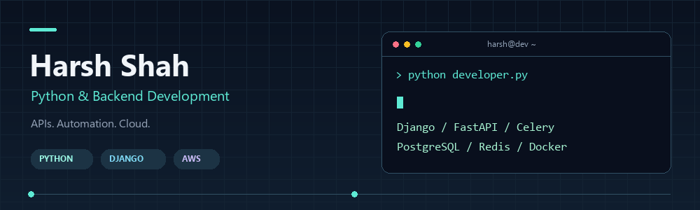

### Hi, I'm Harsh 👋

Python development · Backend systems · Cloud tooling

I work with Python web frameworks, RESTful APIs, background tasks, and relational databases. 
My toolkit spans backend development, asynchronous processing, and AWS infrastructure.

---

## 🧑‍💻 What I work with

| Area | Toolkit |
| --- | --- |
| **Backend & APIs** | Django, Django REST Framework, Flask, FastAPI, RESTful APIs, OpenAPI Specification |
| **Background & async work** | Celery, Async IO, Redis |
| **Data & persistence** | PostgreSQL, MySQL, Django ORM |
| **Cloud & delivery** | AWS SAM, EC2, IAM, RDS, Route 53, S3, Docker, CI/CD |
| **Web fundamentals** | Python, JavaScript, HTML, CSS |
| **Development & operations** | Linux, Nginx, GitHub, Sentry, Jira, VS Code, Jupyter |

## 🛠️ Technology stack

#### Languages

#### Frameworks & API tooling

#### Databases & infrastructure

#### Workflow & observability

---

**Python at the core. APIs, automation, and cloud around it.**

